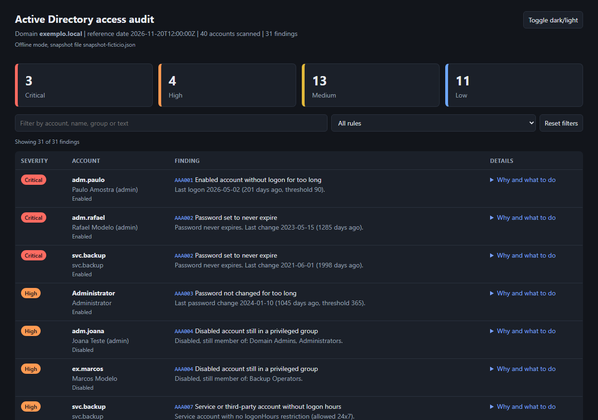

# ad-access-audit

[Português](README.pt-BR.md) | **English**

[](https://github.com/gavicoding/ad-access-audit/actions/workflows/ci.yml)


Read-only Active Directory access audit. One command produces a single HTML report (plus CSV and JSON) with stale accounts, passwords that never expire, forgotten members of admin groups, disabled accounts that still hold privileges and third-party accounts that can log on at any hour, all sorted by severity.



## The problem

Every Active Directory domain collects access debt: the intern who left last year, the service account created in 2019 with "password never expires", the ex-admin who is still in Domain Admins (but disabled, so "it is fine"), the supplier account that can log on at 3 AM on a Sunday. These are real security and privacy (LGPD/GDPR) risks, and the review is usually a pile of loose `Get-ADUser` one-liners that nobody runs twice the same way.

`ad-access-audit` turns that into a repeatable report you can hand to a manager or attach to an audit.

## What it checks

| Rule | Finding | Severity (regular / privileged account) |
|------|---------|------|
| AAA001 | Enabled account without logon for more than `-StaleDays` (90) | Medium / **Critical** |
| AAA002 | Password set to never expire | Medium / **Critical** |
| AAA003 | Password not changed for more than `-PasswordAgeDays` (365) | Low / High |
| AAA004 | Disabled account still in a privileged group | High |
| AAA005 | Member of a privileged group, direct or nested (review list) | Low |
| AAA006 | `adminCount=1` but no longer in any privileged group | Low |
| AAA007 | Service or third-party account without `logonHours` | Medium / High |
| AAA008 | Enabled account that never logged on, created more than `-NeverLoggedOnDays` (30) ago | Medium / High |

Every finding comes with a plain explanation of the risk and a concrete recommendation. The same weakness on an enabled member of a privileged group gets a higher severity, because that is where an attacker wants to land.

**It is read-only.** The module only calls `Get-*` cmdlets from the ActiveDirectory module and never changes anything. A test parses the source code and fails if any write verb (`Set-`, `Remove-`, `New-`, `Add-`, `Disable-`, `Enable-`, `Move-`, `Rename-` and others) or ADSI write method shows up.

## Installation

Requirements: Windows PowerShell 5.1 or PowerShell 7+. For live mode, the ActiveDirectory module (RSAT) and any domain user account; no admin rights are needed to read these attributes. Offline mode needs nothing else.

```powershell
git clone https://github.com/gavicoding/ad-access-audit.git
cd ad-access-audit
Import-Module ./AdAccessAudit/AdAccessAudit.psd1
```

To install for your user, copy the `AdAccessAudit` folder to `Documents\WindowsPowerShell\Modules` (5.1) or `Documents\PowerShell\Modules` (7+).

## Usage

Try it right now with the fictitious sample domain, no Active Directory required:

```powershell
Invoke-AdAccessAudit -InputJson ./samples/snapshot-ficticio.json -OutputPath ./out
```

Audit your domain with the defaults and write the three formats:

```powershell
Invoke-AdAccessAudit -OutputPath C:\Audits\2026-11
```

Stricter thresholds, extra privileged groups, only HTML and CSV:

```powershell
$groups = 'Domain Admins', 'Enterprise Admins', 'Administrators', 'GG-Firewall-Admins'
Invoke-AdAccessAudit -StaleDays 45 -PasswordAgeDays 180 -PrivilegedGroups $groups -Format Html, Csv -OutputPath .\out
```

Export a snapshot on a machine with domain access and audit it somewhere else (or keep it as evidence of who had access on that date):

```powershell
Export-AdSnapshot -Path .\snapshot-2026-11.json
Invoke-AdAccessAudit -InputJson .\snapshot-2026-11.json -OutputPath .\out
```

Use the result object in your own scripts:

```powershell
$audit = Invoke-AdAccessAudit -InputJson ./samples/snapshot-ficticio.json
$audit.Findings | Where-Object Severity -eq 'Critical' | Select-Object Account, Title, Detail
```

### Parameters

| Parameter | Default | Description |
|-----------|---------|-------------|
| `-StaleDays` | 90 | Idle days before an enabled account is reported |
| `-PasswordAgeDays` | 365 | Password age before it is reported |
| `-NeverLoggedOnDays` | 30 | Grace period for new accounts that never logged on |
| `-PrivilegedGroups` | Domain Admins, Enterprise Admins, Schema Admins, Administrators, Account Operators, Backup Operators, Server Operators | Nested groups are expanded |
| `-OutputPath` | none | Folder for the reports. Without it, only the object is returned |
| `-Format` | Html, Csv, Json | Any combination |
| `-InputJson` | none | Offline mode: audit a snapshot file instead of the live domain |
| `-ReferenceDate` | snapshot date or now | Date used as "today" in the age calculations |
| `-ServiceAccountPattern` | `^(svc\|srv\|sa)[-_.]` and "service account" in the description | Accounts with a servicePrincipalName are always service accounts |
| `-ThirdPartyPattern` | `^(ext\|terc\|vnd\|vendor)[-_.]` and words like "vendor", "contractor", "terceiro", "fornecedor" in the description | |
| `-Server`, `-Credential` | current domain | Passed to the `Get-AD*` cmdlets |

## Sample output

Console, using the sample snapshot (40 fictitious accounts in `exemplo.local`):

```text
PS> $r = Invoke-AdAccessAudit -InputJson ./samples/snapshot-ficticio.json -OutputPath ./out
PS> $r.Summary

Name      Value
----      -----
Critical  3
High      4
Medium    13
Low       11

PS> $r.Findings | Select-Object -First 7 Severity, RuleId, Account, Detail

Severity RuleId Account       Detail
-------- ------ -------       ------
Critical AAA001 adm.paulo     Last logon 2026-05-02 (201 days ago, threshold 90).
Critical AAA002 adm.rafael    Password never expires. Last change 2023-05-15 (1285 days ago).
Critical AAA002 svc.backup    Password never expires. Last change 2021-06-01 (1998 days ago).
High     AAA003 Administrator Last password change 2024-01-10 (1045 days ago, threshold 365).
High     AAA004 adm.joana     Disabled, still member of: Domain Admins, Administrators.
High     AAA004 ex.marcos     Disabled, still member of: Backup Operators.
High     AAA007 svc.backup    Service account with no logonHours restriction (allowed 24x7).
```

Files written to `./out`:

```text
ad-access-audit-exemplo.local-20261120.html
ad-access-audit-exemplo.local-20261120.csv
ad-access-audit-exemplo.local-20261120.json
```

The HTML report ([docs/sample-report.html](docs/sample-report.html)) is a single file with inline CSS and JavaScript: severity cards that work as filters, text search, a rule selector, dark and light themes and an expandable "why and what to do" for each finding. It loads nothing from the internet, so it opens fine on an isolated server or as an e-mail attachment.

## Snapshot format

```json
{
  "schemaVersion": 1,
  "domain": "exemplo.local",
  "generatedAt": "2026-11-20T12:00:00Z",
  "users": [
    {
      "samAccountName": "svc.sql",
      "displayName": "svc.sql",
      "enabled": true,
      "whenCreated": "2022-01-20T10:00:00Z",
      "lastLogonDate": "2026-11-18T09:12:00Z",
      "passwordLastSet": "2022-01-20T10:00:00Z",
      "passwordNeverExpires": true,
      "adminCount": 0,
      "description": "SQL Server do sistema interno",
      "servicePrincipalNames": ["MSSQLSvc/sql01.exemplo.local:1433"],
      "logonHours": null
    }
  ],
  "groups": [
    {
      "name": "Domain Admins",
      "alias": "",
      "members": [
        { "name": "adm.carlos", "objectClass": "user" },
        { "name": "GG-TI-Admins", "objectClass": "group" }
      ]
    }
  ]
}
```

`logonHours` is the base64 of the 21-byte AD attribute; `null` or all bits set means "any time". `alias` holds the English name when the domain uses localized group names (for example "Admins. do dominio"); `Export-AdSnapshot` resolves the default groups by their well-known SID, so this works on domains installed in any language.

A real snapshot contains names and account data from your directory. Treat it as personal data: keep it out of public repositories and shared folders (the `.gitignore` already ignores `snapshot-*.json`).

## Known limitations

- `LastLogonDate` comes from `lastLogonTimestamp`, which is replicated with a delay of up to 14 days by design. Good for "90 days idle", not for "who logged on yesterday".
- Service and third-party accounts are detected by naming pattern, description and servicePrincipalName. Adjust `-ServiceAccountPattern` and `-ThirdPartyPattern` to your naming convention.
- Only user accounts are audited. Computer accounts, gMSAs, foreign security principals and members from trusted domains are listed in groups but not evaluated.
- The orphan `adminCount` check compares against `-PrivilegedGroups`. AdminSDHolder also protects groups like Print Operators and Replicator; add them to the list if you use them.
- Fine-grained password policies are not read, so AAA003 uses the same threshold for everyone.
- It reports, it does not fix. That is intentional.

## Development

```powershell
./tools/build-sample.ps1   # rebuilds samples/snapshot-ficticio.json and docs/sample-report.html
./tools/test.ps1           # PSScriptAnalyzer + Pester 5
```

CI runs PSScriptAnalyzer and the Pester suite on `windows-latest`, in both Windows PowerShell 5.1 and PowerShell 7. See [CONTRIBUTING.md](CONTRIBUTING.md).

## License

[MIT](LICENSE)
