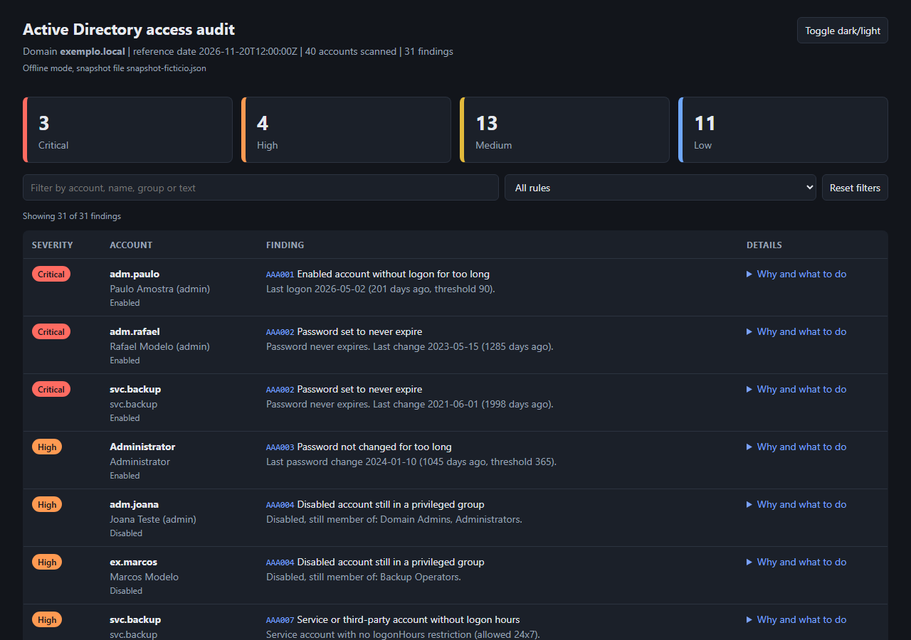

# ad-access-audit

**Português** | [English](README.md)

[](https://github.com/gavicoding/ad-access-audit/actions/workflows/ci.yml)


Auditoria de acessos do Active Directory, somente leitura. Um comando gera um relatório HTML único (mais CSV e JSON) com contas paradas, senhas que nunca expiram, gente esquecida em grupo de administrador, contas desativadas que ainda têm privilégio e contas de terceiros que podem entrar a qualquer hora, tudo em ordem de gravidade.



## O problema

Todo domínio Active Directory vai acumulando sujeira de acesso: o estagiário que saiu no ano passado, a conta de serviço criada em 2019 com "senha nunca expira", o ex-administrador que continua no Domain Admins (desativado, então "tudo bem"), a conta do fornecedor que consegue logar às 3 da manhã de domingo. Isso é risco de segurança e de LGPD, e a revisão costuma ser um monte de `Get-ADUser` soltos que ninguém roda duas vezes do mesmo jeito.

O `ad-access-audit` transforma isso num relatório que dá para repetir todo mês, entregar para o gestor ou anexar numa auditoria.

## O que ele verifica

| Regra | Achado | Gravidade (conta comum / conta privilegiada) |
|-------|--------|------|
| AAA001 | Conta ativa sem logon há mais de `-StaleDays` (90) dias | Medium / **Critical** |
| AAA002 | Senha configurada para nunca expirar | Medium / **Critical** |
| AAA003 | Senha sem troca há mais de `-PasswordAgeDays` (365) dias | Low / High |
| AAA004 | Conta desativada que ainda está em grupo privilegiado | High |
| AAA005 | Membro de grupo privilegiado, direto ou por grupo aninhado (lista para revisão) | Low |
| AAA006 | `adminCount=1` sem estar mais em nenhum grupo privilegiado | Low |
| AAA007 | Conta de serviço ou de terceiro sem `logonHours` | Medium / High |
| AAA008 | Conta ativa que nunca fez logon e foi criada há mais de `-NeverLoggedOnDays` (30) dias | Medium / High |

Cada achado vem com uma explicação simples do risco e uma recomendação concreta. O mesmo problema numa conta ativa de grupo privilegiado sobe de gravidade, porque é ali que um atacante quer chegar.

**É somente leitura.** O módulo só usa cmdlets `Get-*` do módulo ActiveDirectory e nunca altera nada. Um teste lê o código-fonte e falha se aparecer qualquer verbo de escrita (`Set-`, `Remove-`, `New-`, `Add-`, `Disable-`, `Enable-`, `Move-`, `Rename-` e outros) ou método de escrita do ADSI.

## Instalação

Requisitos: Windows PowerShell 5.1 ou PowerShell 7+. Para consultar o domínio ao vivo, o módulo ActiveDirectory (RSAT) e qualquer usuário do domínio; não precisa de permissão de administrador para ler esses atributos. O modo offline não precisa de mais nada.

```powershell
git clone https://github.com/gavicoding/ad-access-audit.git
cd ad-access-audit
Import-Module ./AdAccessAudit/AdAccessAudit.psd1
```

Para instalar só para o seu usuário, copie a pasta `AdAccessAudit` para `Documentos\WindowsPowerShell\Modules` (5.1) ou `Documentos\PowerShell\Modules` (7+).

## Como usar

Teste agora mesmo com o domínio fictício de exemplo, sem Active Directory:

```powershell
Invoke-AdAccessAudit -InputJson ./samples/snapshot-ficticio.json -OutputPath ./out
```

Auditar o seu domínio com os padrões e gerar os três formatos:

```powershell
Invoke-AdAccessAudit -OutputPath C:\Auditorias\2026-11
```

Limites mais rígidos, grupos privilegiados extras, só HTML e CSV:

```powershell
$grupos = 'Domain Admins', 'Enterprise Admins', 'Administrators', 'GG-Firewall-Admins'
Invoke-AdAccessAudit -StaleDays 45 -PasswordAgeDays 180 -PrivilegedGroups $grupos -Format Html, Csv -OutputPath .\out
```

Exportar uma foto do domínio numa máquina com acesso e auditar em outro lugar (ou guardar como evidência de quem tinha acesso naquela data):

```powershell
Export-AdSnapshot -Path .\snapshot-2026-11.json
Invoke-AdAccessAudit -InputJson .\snapshot-2026-11.json -OutputPath .\out
```

Usar o resultado nos seus próprios scripts:

```powershell
$auditoria = Invoke-AdAccessAudit -InputJson ./samples/snapshot-ficticio.json
$auditoria.Findings | Where-Object Severity -eq 'Critical' | Select-Object Account, Title, Detail
```

### Parâmetros

| Parâmetro | Padrão | Para que serve |
|-----------|--------|----------------|
| `-StaleDays` | 90 | Dias sem logon até uma conta ativa ser apontada |
| `-PasswordAgeDays` | 365 | Idade da senha até ser apontada |
| `-NeverLoggedOnDays` | 30 | Prazo de carência para contas novas que ainda não logaram |
| `-PrivilegedGroups` | Domain Admins, Enterprise Admins, Schema Admins, Administrators, Account Operators, Backup Operators, Server Operators | Grupos aninhados são expandidos |
| `-OutputPath` | nenhum | Pasta dos relatórios. Sem ele, só o objeto é devolvido |
| `-Format` | Html, Csv, Json | Qualquer combinação |
| `-InputJson` | nenhum | Modo offline: audita um arquivo de snapshot em vez do domínio |
| `-ReferenceDate` | data do snapshot ou agora | Data usada como "hoje" no cálculo das idades |
| `-ServiceAccountPattern` | `^(svc\|srv\|sa)[-_.]` e "conta de serviço" na descrição | Conta com servicePrincipalName é sempre conta de serviço |
| `-ThirdPartyPattern` | `^(ext\|terc\|vnd\|vendor)[-_.]` e palavras como "terceiro", "fornecedor", "prestador" na descrição | |
| `-Server`, `-Credential` | domínio atual | Repassados aos cmdlets `Get-AD*` |

## Exemplo de saída

No console, com o snapshot de exemplo (40 contas fictícias em `exemplo.local`):

```text
PS> $r = Invoke-AdAccessAudit -InputJson ./samples/snapshot-ficticio.json -OutputPath ./out
PS> $r.Summary

Name      Value
----      -----
Critical  3
High      4
Medium    13
Low       11

PS> $r.Findings | Select-Object -First 7 Severity, RuleId, Account, Detail

Severity RuleId Account       Detail
-------- ------ -------       ------
Critical AAA001 adm.paulo     Last logon 2026-05-02 (201 days ago, threshold 90).
Critical AAA002 adm.rafael    Password never expires. Last change 2023-05-15 (1285 days ago).
Critical AAA002 svc.backup    Password never expires. Last change 2021-06-01 (1998 days ago).
High     AAA003 Administrator Last password change 2024-01-10 (1045 days ago, threshold 365).
High     AAA004 adm.joana     Disabled, still member of: Domain Admins, Administrators.
High     AAA004 ex.marcos     Disabled, still member of: Backup Operators.
High     AAA007 svc.backup    Service account with no logonHours restriction (allowed 24x7).
```

Arquivos gerados em `./out`:

```text
ad-access-audit-exemplo.local-20261120.html
ad-access-audit-exemplo.local-20261120.csv
ad-access-audit-exemplo.local-20261120.json
```

O relatório HTML ([docs/sample-report.html](docs/sample-report.html)) é um arquivo só, com CSS e JavaScript embutidos: cartões de gravidade que funcionam como filtro, busca por texto, seleção de regra, tema escuro e claro e um "por que e o que fazer" em cada achado. Ele não carrega nada da internet, então abre normalmente num servidor isolado ou como anexo de e-mail. Os textos do relatório estão em inglês.

## Formato do snapshot

O formato está descrito no [README em inglês](README.md#snapshot-format). Resumo: `domain`, `generatedAt`, a lista `users` (com `samAccountName`, `enabled`, `lastLogonDate`, `passwordLastSet`, `passwordNeverExpires`, `adminCount`, `description`, `servicePrincipalNames` e `logonHours` em base64) e a lista `groups` com os membros de cada grupo privilegiado.

O campo `alias` guarda o nome em inglês quando o domínio usa nomes de grupo traduzidos (por exemplo "Admins. do domínio"). O `Export-AdSnapshot` encontra os grupos padrão pelo SID conhecido, então funciona em domínios instalados em qualquer idioma.

Um snapshot real tem nomes e dados de contas do seu diretório. Trate como dado pessoal: não suba em repositório público nem em pasta compartilhada (o `.gitignore` já ignora `snapshot-*.json`).

## Limitações conhecidas

- O `LastLogonDate` vem do `lastLogonTimestamp`, que por projeto replica com atraso de até 14 dias. Serve para "90 dias parado", não para "quem logou ontem".
- Contas de serviço e de terceiros são identificadas pelo padrão do nome, pela descrição e pelo servicePrincipalName. Ajuste `-ServiceAccountPattern` e `-ThirdPartyPattern` para o padrão de nomes da sua empresa.
- Só contas de usuário são avaliadas. Contas de computador, gMSAs, objetos de outros domínios confiáveis aparecem nos grupos mas não são analisados.
- O teste de `adminCount` órfão compara com `-PrivilegedGroups`. O AdminSDHolder também protege grupos como Print Operators e Replicator; inclua na lista se você usa.
- Políticas de senha refinadas (fine-grained) não são lidas, então a AAA003 usa o mesmo limite para todo mundo.
- Ele aponta, não corrige. Isso é de propósito.

## Desenvolvimento

```powershell
./tools/build-sample.ps1   # recria samples/snapshot-ficticio.json e docs/sample-report.html
./tools/test.ps1           # PSScriptAnalyzer + Pester 5
```

O CI roda o PSScriptAnalyzer e os testes Pester no `windows-latest`, no Windows PowerShell 5.1 e no PowerShell 7. Veja o [CONTRIBUTING.md](CONTRIBUTING.md).

## Licença

[MIT](LICENSE)
